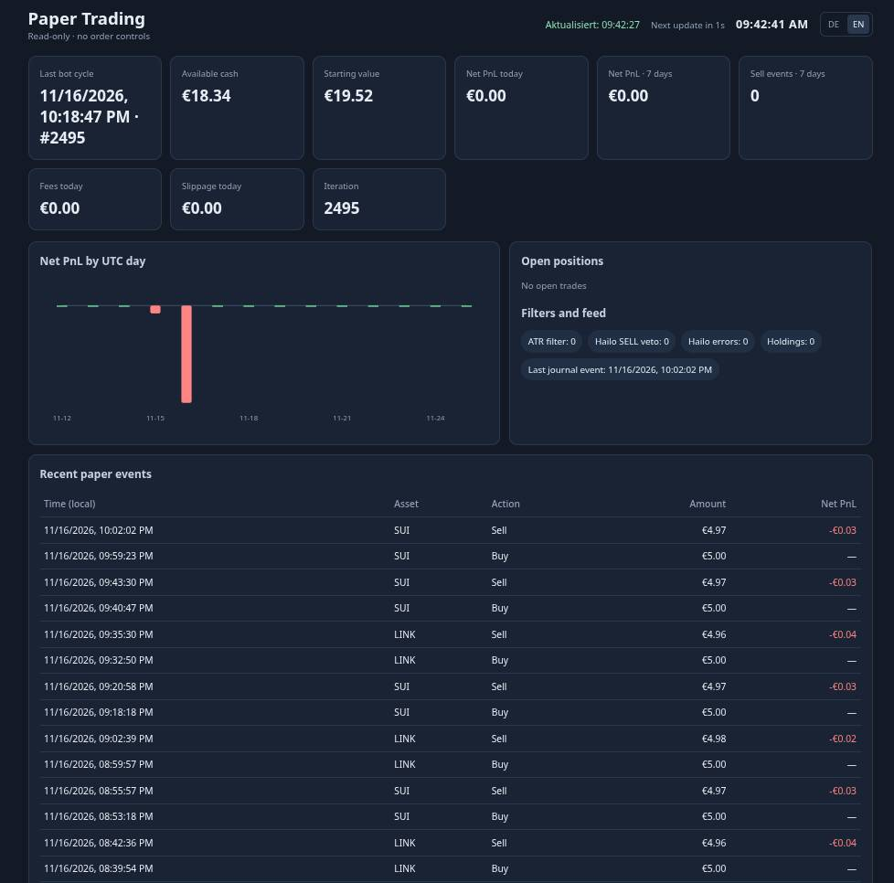
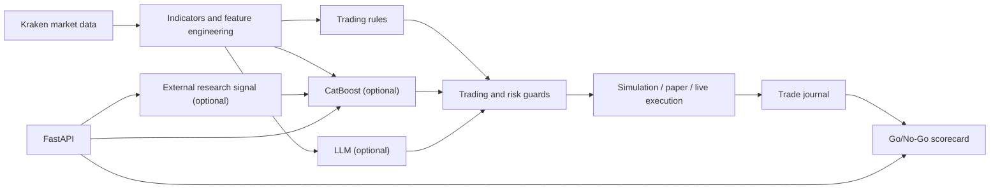

<p align="center">
  <picture>
    <source media="(prefers-color-scheme: dark)" srcset="assets/logo-dark.png" width="204">
    <source media="(prefers-color-scheme: light)" srcset="assets/logo-transparent.png" width="295">
    
  </picture>
</p>

<h1 align="center">Crypto Trading Bot</h1>

<p align="center">
  <a href="https://github.com/sikienzl/TradingBot/actions/workflows/ci.yml">
    
  </a>
</p>

A modular crypto-trading research pipeline for Kraken: collect market data,
engineer features, use rules and optional CatBoost/LLM signals, and evaluate
strategies through backtesting or paper trading. Live trading is also available
but requires explicit configuration and careful risk management.

**Anti-leakage:** CatBoost training uses chronological splits and, when enough
data is available, expanding-window walk-forward evaluation. Training rows
whose forward label window overlaps validation are removed, and the latest
research signal is not copied into historical training data. These safeguards
reduce lookahead risk; input features must still be time-aligned and results
should be checked on a fresh, untouched period.

## Example output

On a fresh checkout without a trade journal, the scorecard reports insufficient
data rather than suggesting a trade:

```text
=== Go/No-Go Scorecard ===
File:                 trade_journal.csv
Closed trades:        0
VERDICT:              HOLD

Reason(s):
- Journal file not found; scorecard cannot evaluate recent trading data in this environment.
```

This is the output of the quickstart below; `HOLD` exits with code 2.
Scorecards based on real journals may return `GO`, `HOLD`, or `NO-GO`.

## Monitoring Dashboard

A lightweight, read-only web dashboard tracks paper-trading balances, daily net PnL, filter vetoes, and live Kraken market spreads without exposing order controls:

<p align="center">
  
</p>

## Architecture



## Deployment options

| Setup | Suitable for | Components |
|---|---|---|
| Local computer | Getting started, development and backtesting | Rules with optional local CatBoost or LLM; no special hardware required |
| Raspberry Pi 4 without Hailo | A small, always-on bot | Rules and optional Mammouth.ai API copilot; no Hailo accelerator needed |
| Sipeed Nano cluster with two CM5 modules | Separating bot and inference workloads | One node can run the bot and another an optional Hailo inference service; the documented Hailo setup is a simulation/shadow deployment |

These are alternatives, not prerequisites for each other. External APIs require
network access and their own credentials. Start with simulation or paper
trading. See [deployment options and prerequisites](docs/DEPLOYMENT.md) and the
[CM5 cluster architecture](docs/CLUSTER_ARCHITECTURE.md) for the observed
hardware roles, services, and boundaries.

## Quickstart

Requires Python 3.12+ and Git. Set up the environment once (installation time
depends on your system and network):

```sh
git clone https://github.com/sikienzl/TradingBot.git
cd TradingBot
python3 -m venv .venv
. .venv/bin/activate
pip install -e .
```

Then run the offline scorecard in seconds; no API keys or market connection
are needed:

```sh
python3 -m src.go_no_go_scorecard --file trade_journal.csv
```

The example output above assumes `trade_journal.csv` does not yet exist.
To collect data, run a backtest, or start a simulated bot, see the
[setup and usage guide](docs/USAGE.md). The `--backtest` command currently
continues into the bot afterward; read the guide before running it.

## Documentation

- [Setup, API, training, backtesting, and usage](docs/USAGE.md)
- [Configuration and risk guardrails](docs/CONFIGURATION.md)
- [AutoResearch signal bridge](docs/AUTORESEARCH.md)
- [Weekly scorecard and monitoring](docs/MONITORING.md)
- [CM5 cluster architecture](docs/CLUSTER_ARCHITECTURE.md) and [architecture audit](docs/ARCHITECTURE_AUDIT.md)
- [Server deployment](docs/DEPLOYMENT.md) and [full server runbook](SERVER_README.md)
- [Changelog](CHANGELOG.md) · [Contributing](CONTRIBUTING.md) · [Security](SECURITY.md)

**Risk warning:** This software is for research and education, not financial
advice. Backtest and paper trade first; trading can result in the loss of all
invested capital. See the [full disclaimer](docs/USAGE.md#disclaimer--risk-warning).
