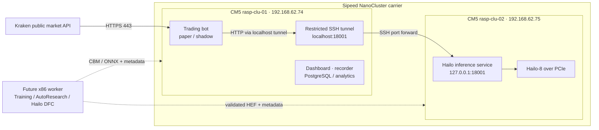

# CM5 Cluster Architecture

The cluster is an optional deployment profile, not a dependency of the bot.
The bot remains usable on a single Raspberry Pi without Hailo hardware or any
cluster services. The currently documented cluster trading workload is a
simulation/shadow deployment; it is not approved or validated for live trading.

## Hardware and observed topology

The Sipeed NanoCluster carrier hosts two Raspberry Pi Compute Module 5 (CM5)
modules. During a read-only inspection on 2026-11-25, the nodes reported the
following hostnames and private-LAN addresses:

| Node | Address | Observed role and hardware |
|---|---|---|
| `rasp-clu-01` | `192.168.62.74` | Bot/paper host. Runs the restricted Hailo SSH tunnel, paper dashboard, public-market recorder, PostgreSQL and paper/shadow containers. |
| `rasp-clu-02` | `192.168.62.75` | Hailo inference host. Runs `trading-hailo-dryrun.service` on localhost. `hailortcli scan` detected Hailo device `0001:01:00.0`; PCI enumeration identified a Hailo-8 (`1e60:2864`). |
| Future x86 worker | Not provisioned | Intended for CatBoost/ONNX training, AutoResearch, and the x86-64 Hailo Dataflow Compiler (DFC). It is not currently part of the deployed topology. |

The IP addresses above describe the inspected private LAN, not portable
defaults. Do not put credentials, SSH keys, bearer tokens, or production
inventories in Git. The generic `cluster-starter/` Ansible project has example
master/worker placeholders; it does not establish that the live nodes are
configured as K3s master and worker.

## Responsibilities

| Component | Responsibility | Important boundary |
|---|---|---|
| `.74` bot/paper host | Runs isolated paper/shadow workloads and operational services. The observed `trading-hailo-shadow-dryrun` container uses `DRY_RUN=true` and simulated data according to the runbook. | Exchange credentials and order execution stay on the bot side; the inference host does not need Kraken trading credentials. Enable the shared PostgreSQL execution lease before allowing another node to own the same account. |
| `.75` Hailo host | Serves local Hailo-8 inference using `trading-hailo-dryrun.service`, bound to `127.0.0.1:18001`. | Hailo is an optional accelerator backend. The running service and shadow workload are not evidence of live-trading readiness. |
| Future x86 worker | Produces candidate models, runs chronological/Walk-Forward evaluation and AutoResearch, and compiles Hailo-compatible ONNX to `.hef` with DFC. | No x86 worker or automated promotion path was observed. It must not place orders or become a runtime dependency for a Pi. |

The intended inference fallback is Hailo, then local CPU CatBoost/ONNX, then
rules-only. `src.inference_backend.build_tabular_predictor` implements that
order: with `TABULAR_MODEL_BACKEND=hailo` it wraps the remote Hailo predictor in
`src.inference_fallback.TabularInferenceFallback`, which retries on the local CPU
CatBoost predictor when the Hailo service is unreachable, returns an invalid
prediction, or the Hailo package/device is missing, and finally returns a HOLD
prediction with `backend=rules_only` when the CPU model is also unavailable. The
selected backend and every fallback are logged. With
`TABULAR_MODEL_BACKEND=catboost` only the CPU predictor is loaded and a missing
model simply means rules-only. A rules-only result never turns into a BUY, and
the hard risk guardrails are evaluated independently afterwards. The CI
`Inference fallback matrix` job runs that matrix with no Hailo package, device or
model files installed; continuous readiness probing of the target-cluster Hailo
service is still an operator task.

## Network, services, and ports

| Port / protocol | Use | Exposure |
|---|---|---|
| TCP 22 / SSH | Restricted tunnel from `.74` to `.75`. | Limit the tunnel key to port forwarding to `127.0.0.1:18001`; verify and pin the host key. |
| TCP 18001 / HTTP | Hailo inference API. | The service binds to loopback on `.75`; the bot reaches its own loopback through the SSH forward. Do not expose it directly to the LAN or Internet. |
| TCP 443 / HTTPS | Public Kraken market endpoints and any explicitly configured external API. | Outbound only as required; paid APIs are optional. |
| TCP 6443 / K3s API | Optional generic cluster-starter K3s control plane. | Only if K3s is enabled; allow only controller/worker traffic. Required CNI traffic depends on the selected K3s/CNI configuration. |
| TCP 9100 | Optional Prometheus node-exporter scrape target. | Restrict to the monitoring host. |
| TCP 9090, 9200 | Prometheus and the PnL exporter in the repository's monitoring configuration. | Bind/firewall according to the chosen host deployment; not required by the bot. |
| TCP 5432 | Optional PostgreSQL analytics. | The cluster starter defaults PostgreSQL to loopback. Remote access is opt-in and must use a narrow client CIDR and separately secured transport. |
| TCP 8443 / HTTPS | Optional authenticated paper dashboard. | Restrict to approved private/VPN client networks as described by `ansible/README.md`. |

Observed user services on `.74` included `trading-hailo-tunnel.service`,
`public-market-recorder.service`, and `public-paper-dashboard.service`. Running
containers included the paper dashboard, market recorder, PostgreSQL, a paper
analytics bot, and `trading-hailo-shadow-dryrun`. On `.75`,
`trading-hailo-dryrun.service` was active. These are inspection-time facts;
service state can change. Service definitions are in `deploy/`, and the generic
infrastructure starter is in `cluster-starter/`.

K3s is not a requirement for the observed Hailo tunnel path. The starter
explicitly does not provide a Hailo Kubernetes device plugin, device scheduling,
HA, or a trading-bot deployment. Docker and K3s containerd are separate runtimes.

## Model artifacts and synchronization

- `.75` needs a compatible compiled `.hef` and its matching `metadata.json`.
  The current shadow runbook stores these under
  `~/trading-hailo-dryrun/model/`; paired releases can instead use
  `/opt/trading-models/active/hailo/`.
- The `.74` CPU path uses CatBoost and its matching metadata under
  `/opt/trading-models/active/cpu/` when following a paired release. Rules-only
  operation must remain possible without either artifact.
- The Hailo trainer exports ONNX and metadata; compatible x86-64 DFC compilation
  to `.hef` remains a separate operator step. Train CatBoost with
  `--feature-contract hailo` from the exact same input data to produce the CPU
  fallback.
- `scripts.manage_model_release` verifies paired feature/label contracts and
  training-data hashes, requires validation results and training provenance on
  both sides, publishes immutable versioned directories with
  checksums and the full per-side validation reports in `manifest.json`, and
  atomically switches the `active` symlink. Rollback validates
  the old checksums before activation. `validate` re-checks a stored release's
  manifest, contract agreement and artifact checksums and prints both sides'
  validation reports without touching `active`, so each node can confirm what it
  is about to run. Copy or synchronize the completed
  immutable release to each node over a trusted channel; the promoter itself
  does not transfer files across the network.
- Which release a node is running is readable per host: set
  `TRADING_MODEL_RELEASE_ROOT` to that node's release root and
  `src.model_release.read_active_release` reports the active release ID, feature
  contract, feature tuple, training-data hash and per-artifact checksum
  verification without changing anything. The bot logs that state at startup and
  `scripts.export_operational_health` publishes it as gauges, so the monitoring
  node reads its own host's release tree read-only and never follows a network
  path. The variable is unset by default; a node that does not use paired
  releases publishes no release gauge and cannot match the release alerts.
- Promotion is gated on a fresh `GO` scorecard verdict
  (`src.scorecard_gate`): the CLI reads
  `results/scorecards/latest_status.json`/`latest_status.env` relative to its
  working directory and refuses without a recent `GO`. On the cluster that
  marker comes from the `scorecard.timer`/`scorecard-status.timer` units, which
  the inspected `.74`/`.75` topology does not currently run - install them on the
  host that promotes, or promote with `--no-require-go-verdict` deliberately.
  `rollback` is never gated, so reverting to a known-good release stays possible
  after a `NO-GO`.
- Keep the previous known-good release directory. Target-device HEF loading,
  simulation/shadow evaluation, and explicit operator approval are still
  required before live use.

## Cluster execution ownership

The bot always holds a process-local non-blocking lock. That lock does not
coordinate the two CM5 hosts. Before enabling more than one candidate execution
node for a Kraken account, configure all candidates with
`TRADING_CLUSTER_EXECUTION_LEASE_ENABLED=true`, the same
`TRADING_CLUSTER_EXECUTION_LEASE_DATABASE_URL`, and a stable
`TRADING_EXECUTION_ACCOUNT_ID`. They then contend for a PostgreSQL session
advisory lock scoped to that account; the holder verifies the session lock
before each live order. The lease is optional and is not needed by the
single-Pi release. If PostgreSQL is unavailable or ownership cannot be
verified, cluster live execution must stop rather than fall back to local-only
locks. Validate this behavior against the actual shared database before
enabling a second execution process.

The append-only research news store (`data/research_news_items.jsonl`) is also a
host-local file: it is written only by the node that runs
`scripts/fetch_research_signal.py` and is read through the
`integration.news_store_path` entry of the signal file. Sharing the signal
directory read-only is enough for another node to replay the same per-item
history; there is no cross-node write coordination for the store.

Retention for that store and for the verdict history
(`results/scorecards/verdict_history.jsonl`) is repository code
(`src/jsonl_retention.py`, applied by `scripts/prune_jsonl_stores.py`) and is
installed as `jsonl-retention.timer` on the single-Pi profile. The inspected
cluster has no such unit, so both files still grow there until an operator
installs it. The pruner rewrites a store in place under the same host-local
`flock` its writer uses and keeps the file inode, which protects a concurrent
appender on that host but coordinates nothing across nodes. Therefore exactly one
node per store may run the timer - the node that owns the file - and a second node
pruning the same store can only duplicate work or race the lock. Nothing in the
cluster path requires retention: `TRADING_JSONL_RETENTION_ENABLED=0` keeps the
previous append-only behaviour, and each pass keeps a rotating
`<store>.bak-<UTC stamp>` copy for rollback.

The durable risk-state file (`TRADING_RISK_STATE_FILE`) and the kill-switch
marker are host-local files, not cluster services. Each node therefore keeps its
own daily-loss budget, loss-streak pause, hourly BUY budget and re-entry
cooldowns, and an uncertain order outcome or an unwritable risk-state file only
latches that node's marker. A cluster-wide shared switch and a shared risk-state
store remain open work; until they exist, run exactly one candidate execution
node per account.

Fill reconciliation (`src.fill_reconciliation`) is likewise host-local and belongs
to the node that owns the account: the bot pass reads that host's journal and the
`fill-reconciliation.timer` unit writes its marker under the deployment root
(`results/fill_reconciliation/`), which the operational-health exporter on the same
host publishes. There is no cross-node coordination and no shared report store, so
only the execution owner should run the timer - a second node reconciling the same
account duplicates private Kraken calls without adding coverage. A `DRY_RUN=true`
workload such as the observed `.74` shadow container is skipped by design because a
paper journal has no exchange side, so the inspected cluster currently exercises
none of this path; validating it against a live account remains an operator step.

Per-decision inference backend counters (`src.inference_decision_stats`) are also
host-local: the bot that runs the analysis path writes
`results/inference/backend_stats.json` under its own deployment root and the
operational-health exporter on the same host publishes the backend mix. That is
the cluster signal for a quiet `hailo -> cpu -> rules_only` fallback, because the
observed cluster has no Hailo readiness probe; the counters describe the node
that wrote them and are never shared or merged across nodes. A node that runs no
analysis path publishes no counters, and the exporter reports
`trading_inference_stats_present=0` for it rather than an empty mix.

The active model release is likewise read per host. `TRADING_MODEL_RELEASE_ROOT`
points at that node's own release tree, `src.model_release.read_active_release`
re-verifies the `active` release's manifest and artifact checksums, and the
operational-health exporter on the same host publishes
`trading_model_release_present`, `trading_model_release_artifacts_ok`,
`trading_model_release_features` and `trading_model_release_age_seconds`. Because
each node reads only its own filesystem, a release that was synchronized to one
node but not the other shows up as a different release ID or a failed
verification on the node that is behind; there is no shared release store and no
cross-node release comparison. The variable is unset by default, so a host that
never promotes paired releases publishes `trading_model_release_enabled=0` and
cannot match either release alert.

## Single-Pi boundary

The CM5 cluster is optional. The Raspberry Pi release can run the rules-based
bot, local state, and scorecard as a standalone service without a Hailo-8,
`hailo_platform`, SSH tunnel, K3s, PostgreSQL, or second worker. CatBoost is an
optional local backend. Missing hardware or model dependencies must not prevent
rules-only startup. See [Pi deployment](DEPLOYMENT.md#raspberry-pi-4-without-hailo)
and the [architecture audit](ARCHITECTURE_AUDIT.md).

## Related runbooks

- [Server and current shadow deployment](../SERVER_README.md#current-cluster-shadow-deployment)
- [Generic CM5/K3s infrastructure starter](../cluster-starter/README.md)
- [Deployment profiles](DEPLOYMENT.md)